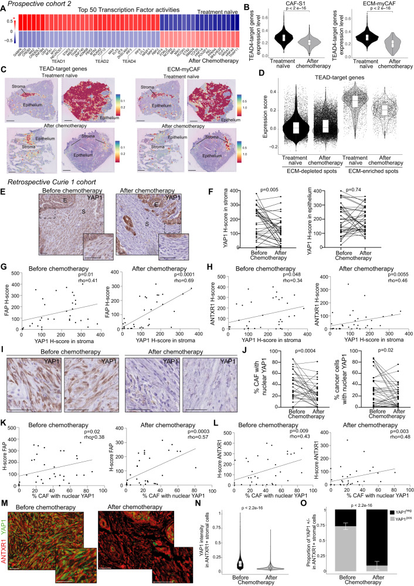
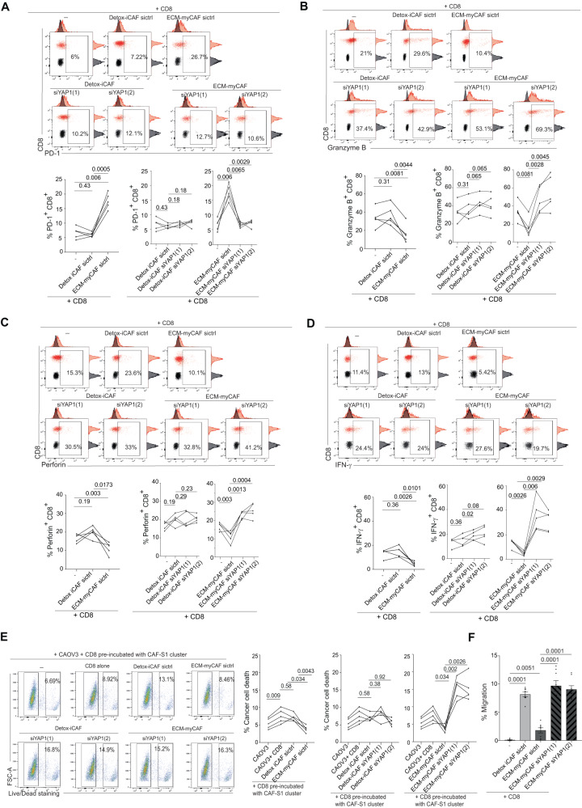
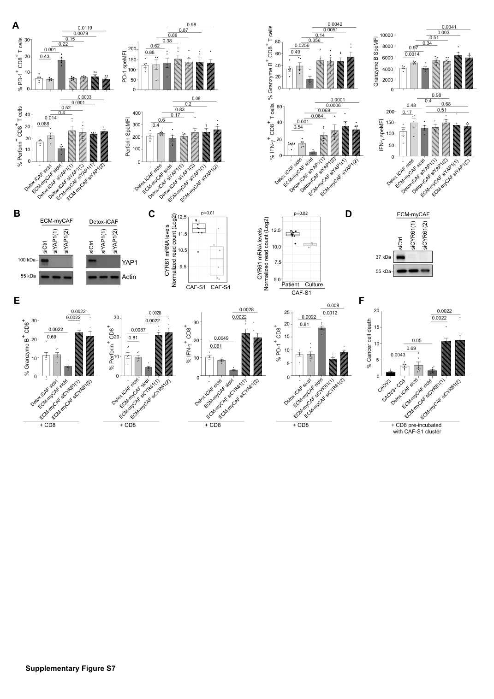

# 用 AI 读机制论文：从研究问题到证据判断

读完一篇论文，能复述作者的故事，还不等于能解释每个结论是怎样得到的。尤其当标题同时出现某类细胞、信号通路和疾病表型时，组织相关性、体外干预与机制解释很容易被连成一条看似完整的因果链。

这份教程帮助你把 AI 的解读变成可以回到原文检查的判断：先看研究在比较什么，再看每项实验实际测了什么，最后确定结论能说到哪一步。你可以直接复制提示词，也可以对照案例练习读图与核查。

| 你想做什么 | 从这里开始 |
|---|---|
| 用自己的论文练习 | [阅读提示词](prompts/reading_workflow.md) |
| 跟着完整案例读 | [论文摘录](cases/input_paper.md) → [解读示例](cases/ai_output.md) → [原文核查](cases/verification.md) |
| 比较两种提问方式 | [普通提问](prompts/baseline.md) / [结构化提问](prompts/reading_workflow.md)，以及[案例条件](cases/experiment.md) |
| 准备组会或借鉴实验 | [关键问题清单](cases/evaluation.md)、[修正后的结论](cases/verification.md#3-可用于组会的修正表述) |

## 一、阅读方法：每个判断都要有对应的实验

### 先写清楚问题，再让 AI 整理答案

“这篇论文讲了什么”适合初读，但不够具体。更有用的问题往往是：某个表达量下降发生在哪类细胞？总量变化与核定位变化是否一致？敲低一个基因后功能改善，支持的是功能贡献，还是已经证明了上下游连接？

把问题写成一句包含**对象、处理、比较和读出**的话。例如：“在患者来源 CAF 与 CD8 T 细胞共培养中，YAP1 敲低改变了哪些细胞毒相关读出？”这样的提问能帮助你找到相应实验，也方便检查 AI 有没有把其他体系的结果混进来。

### 按这个顺序读

1. **确定材料范围。** 分清全文、摘录、图像、图注和补充材料。没提供的内容不能被写成论文没有做；图片没有进入输入时，不能让模型声称看过染色或散点。
2. **建立研究框架。** 用小标题定位问题，再查样本分组、处理和对照。写作顺序可以帮助导航，但不等于真实研究过程。
3. **逐个关系找证据。** 对每个主张记录实验操作、比较对象、读出和原文位置，不要求整篇论文都串成一条单线。
4. **联读图、图注、Results 与 Methods。** 核对坐标、分组、误差棒、重复数与统计方法；患者、供体、切片、细胞和 spot 不是同一个统计单位。
5. **提取能借鉴的条件。** 列出模型来源、干预与阴性对照、剂量、时长、培养比例、功能读出及统计。缺少的条件明确列出，不用常见做法补齐。
6. **修订结论。** 将原文事实、解释和待验证假设分开。只提出会改变当前判断的补查或实验建议。

可以从这张表开始：

| 主张 | 原文位置 | 实际操作与对照 | 支持什么 | 尚不能推出什么 |
|---|---|---|---|---|
| 某细胞中的 A 影响功能 C | Results 段落、分图、Methods | 干预、阴性对照、读出、重复 | 观察、关联或该体系下的功能贡献 | 未检验的方向、机制连接或外推条件 |

**必要性、充分性、直接结合、上下游调控与机制中介回答不同的问题。** 它们不是一张自动递增的证据等级表。两条 siRNA 仍属于同向失功能干预；gain-of-function 不是讨论必要性的固定前提；没有回补实验也不意味着已有功能证据一律无效。判断要回到具体设计与对照。

## 二、怎样使用这套提示词

### 用自己的论文

准备论文文字、关键图像及相应图注，复制[阅读提示词](prompts/reading_workflow.md)，把其中的案例问题换成你自己的问题。标明哪些材料已经提供，哪些还没有提供。长文可以按章节分批上传，但每次都要检查回答引用的位置是否真实存在。

第一轮先得到问题框架与证据表。第二轮只核查最影响理解的几项判断：结论方向、实验分组、必要的对照、统计单位，以及模型是否把“未报告”写成了“没有效果”。不要因为表格完整或表述流畅，就跳过原文核对。

### 跟着本案例练习

1. 阅读[论文摘录](cases/input_paper.md)，先关注 `[P9]`、`[P12]` 和 Fig. 4/6 图注。
2. 用[普通提问](prompts/baseline.md)或[结构化提问](prompts/reading_workflow.md)独立回答同一组问题。需要固定角色说明时可使用[系统提示词](prompts/system.txt)。
3. 对照[普通回答](cases/baseline_output.md)和[结构化回答](cases/ai_output.md)，标出有依据、遗漏、说错和仍需补查的位置。
4. 再阅读[核查记录](cases/verification.md)并查看原图，比较判断为何发生变化。

两份示例来自真实模型运行，保留了原始回答，包括错误。它们不是标准答案。本案例使用相同文字材料、问题和生成设置，各运行一次；图片用于后续原文核查，没有输入这两次模型请求。模型、日期、参数与适用边界见[案例条件](cases/experiment.md)。

## 三、真实案例：YAP1、CYR61 与 CD8 功能

案例论文：Licaj 等，*Residual ANTXR1+ myofibroblasts after chemotherapy inhibit anti-tumor immunity via YAP1 signaling pathway*，Nature Communications 2024;15:1312，DOI [10.1038/s41467-024-45595-3](https://doi.org/10.1038/s41467-024-45595-3)。研究包含患者组织、单细胞与空间分析、原代细胞功能实验，适合练习区分证据的含义。

### “YAP1 下降”究竟测了什么

P9 与 Fig. 4F 显示间质 YAP1 H-score 下降，而上皮 H-score 无显著变化。Fig. 4J 显示的则是间质与癌细胞的核 YAP1 染色均下降。两者测量的内容不同，不能互相替代。“无显著变化”也不等于已经证明完全相同。

Fig. 4，Licaj et al., 2024，CC BY 4.0，未改变分图、颜色或数值。F 为总量，J 为核定位；N/O 还显示残余 ANTXR1+ CAF 的 YAP1 染色降低，以 YAP1−/Low 为主。低染色不能被直接写成所有细胞都没有 YAP1。

### 有功能证据，是否就证明了整条机制

P12、Fig. 6 与 S7 显示：在相关共培养体系中，敲低 YAP1 或 CYR61 可改善 CD8 的部分效应标志和杀伤读出。因此，CYR61 不能被说成只有表达证据、没有功能实验。

但分别干预两个节点，不足以独立证明 YAP1 经 CYR61 完全介导免疫抑制。讨论这条连接时，应补查同一体系中 YAP1 干预后的 CYR61 变化，以及能区分该连接的功能实验。这是针对当前问题的证据需求，不是要求所有通路的每一跳都做相同实验。

Fig. 6，Licaj et al., 2024，CC BY 4.0。A–E 是细胞毒相关读出，F 是迁移。A–E 的 n=5 指独立实验次数；A 使用配对 Wilcoxon，B–E 使用配对 t 检验。F 的 n=8，使用非配对 t 检验，不能统一抄成同一种重复或检验。

Fig. 6F 还留下一个需要澄清的问题：图注提到 siYAP1 条件，原图 F 却只标 CD8 单独、Detox-iCAF、ECM-myCAF，P12 也没有报告 YAP1 干预对迁移的方向。**这组材料不足以判断 YAP1 敲低改变或不改变迁移。** 不能从相邻的杀伤实验推导答案。

S7 来自 Supplementary Information 第 15 页，仅渲染页面。D 为 CYR61 敲低验证，E/F 为效应标志与杀伤；[原图注](cases/figures/s7_caption.txt)提供重复与统计条件。图片及完整出处见[材料来源](cases/figures/SOURCES.md)。

### 两种回答都还需要核查

| 需要检查的判断 | 本案例中的表现 | 更准确的表述 |
|---|---|---|
| 总量与核定位 | 两份回答均能区分；结构化表格仍有“上皮不变”的简写 | 上皮总 H-score 无显著变化 |
| CYR61 功能 | 两份回答都读到了相关功能实验 | 支持该体系下的功能贡献 |
| YAP1→CYR61 连接 | 普通回答先串联功能方向，后又承认中间缺口 | 分别说明节点功能与连接证据 |
| YAP1 与迁移 | 普通回答写成“不改变”；结构化回答也未明确图注与原图的差异 | 当前材料不足以确定该干预的迁移结果 |
| 必要性与充分性 | 结构化回答把缺少 gain-of-function 用作否定必要性的理由 | 依据失功能设计、特异性与对照判断，不混淆两个问题 |
| 材料范围 | 两份回答都有把摘录缺项扩大为论文缺项的表述 | 写“本次材料未显示”，再决定是否查全文 |

逐项来源、仍未解决的问题及适合组会使用的表述见[原文核查](cases/verification.md)。

## 四、换一篇论文时，哪些可以沿用

可以沿用的是提问顺序、证据表和核查方法。应重新确定的是科学问题、关键比较与判断标准。不要只替换 DOI，就把本案例对 YAP1、CYR61 或某种实验的结论套进新论文。

基础机制、临床试验和方法学论文需要不同的证据。材料未提供、论文未报告、没有检验和结果不显著也必须分别表述。细胞或 spot 很多，不自动意味着独立患者很多；单篇没有验证某个机制，也不自动构成领域空白。

本案例仅涉及一篇论文，每种提问方式一次运行，不能据此宣称结构化流程普遍更准确、更快或更便宜。核查包含 AI 辅助，不属于独立人工金标准；未复做生物实验或重算原始数据。阅读方法的价值在于让判断更容易检查，结论仍须由相应证据支持。

## 论文出处与许可

论文文字、发现及 Fig. 4/6、S7 归 Licaj 等作者所有，按 [CC BY 4.0](https://creativecommons.org/licenses/by/4.0/) 署名使用。原图处理说明见[材料来源](cases/figures/SOURCES.md)。教程和提示词按 [CC BY 4.0](LICENSE) 提供；模型回答作为案例记录保留，不作为独立验证的科学来源。
