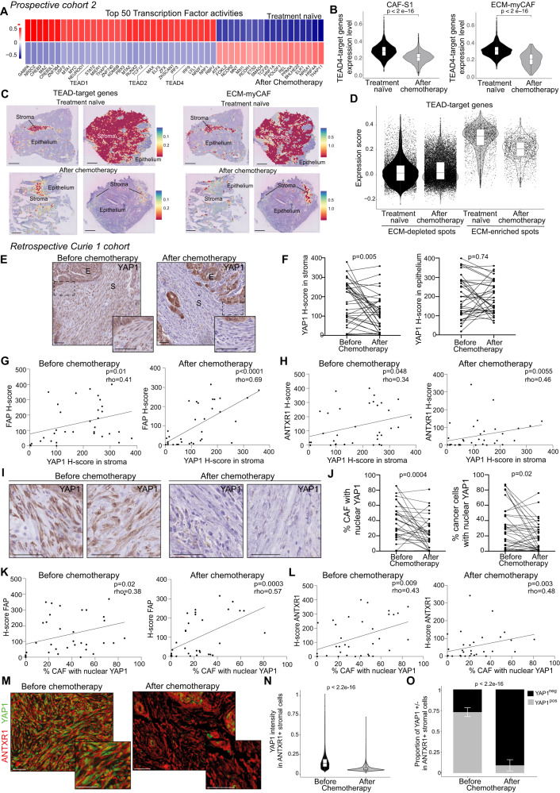
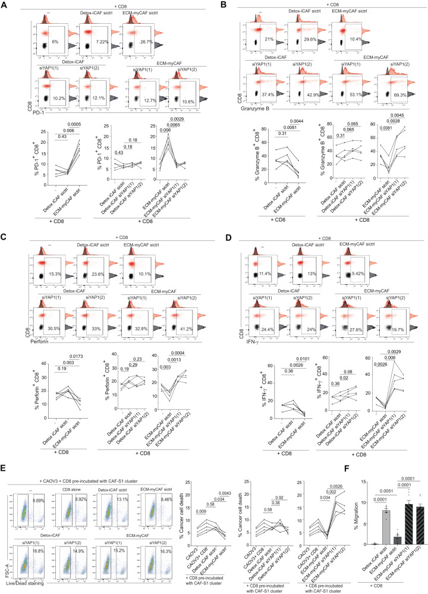
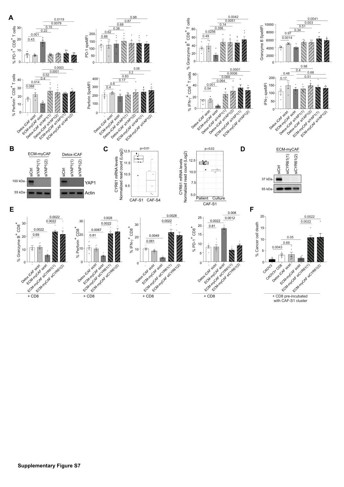

# 用 AI 读机制论文：从研究问题到证据判断与设计接管

把论文读成可以讨论和借鉴的研究思路，需要看清问题、实验与结论怎样相连。本教程从“对象、处理、比较、读出”四个要素出发，建立一套可操作的“主张-证据审定装置”，结合原图核对关键判断，区分组织关联、功能实验与机制解释，并为读者提供可迁移至自己课题的实验设计语法。

配套可直接使用的提示词、完整模型回答、逐项原文核查、组会避坑清单与课题迁移可行性评分卡，帮助生命科学研究者准备组会、理解实验设计，并在自己的实验台上重建严密对照。

---

## 0. 评委与读者 3 分钟速览路由表

为便于同行裁决与读者快速检索，全套方法、实证与工具链条的精确映射如下：

| 评估维度 / 核心关注 | 关键交付物与路径 | 核心证据形态 | 读者可带走什么 |
|---|---|---|---|
| **研究问题与方法定义** | [阅读提示词](prompts/reading_workflow.md) / [论文摘录](cases/input_paper.md) | 四要素提问框架 + 双模型结构化输入 | 可复用的机制论文提问模板 |
| **真实实践与失败修正** | [原文核查记录](cases/verification.md) / [案例条件](cases/experiment.md) | 保留初读模型事实错误并逐项修正 | 识别 AI 幻觉与推论越级的真实对照 |
| **可复现与环境完备** | `tools/` / `cases/runs/` | 依赖定义、运行参数与请求哈希校验 | 零门槛一键复现的校验脚本 |
| **系统化精读与因果框架** | [verification.md 第 1–3 节](cases/verification.md) | LoF × GoF 表型镜像表 + Rescue 四级因果阶梯 | 区分必要性、充分性与上位调控的审定装置 |
| **原文硬核查（Panel/统计）** | [verification.md 第 1 节](cases/verification.md#一关键图件原文四问硬核查表) | Fig. 4、Fig. 6、Suppl. Fig. S7 原文四问硬核查表 | 针对 n 分母、分析单位与统计检验的对质凭据 |
| **证据边界与避坑清单** | [evaluation.md 第 1 节](cases/evaluation.md#一组会避坑清单八类高频因果断裂与识破法则) | 八类高频因果断裂 × 翻车台词 × 审稿人批注 | 组会汇报与审稿可背诵的防翻车卡片 |
| **课题迁移与先导协议** | [evaluation.md 第 2–3 节](cases/evaluation.md#二课题迁移评估tfs-可行性评分卡10-分制--一票否决) | TFS 可行性评分卡 (10分制+一票否决) + G0-G4 先导实验 | 在自己实验台落地新靶点的避坑协议 |
| **计算平台生态实践** | [玻尔平台使用与实测](#在玻尔科学空间中使用) | 真实任务上传、连续原文、分块补读与生态建议 | 真实科研平台上的落地体验与高价值反馈 |

---

## 一、阅读方法：每个判断都要有对应的实验

### 1.1 先写清楚问题，再让 AI 整理答案

“这篇论文讲了什么”适合初读，但不够具体。更有用的问题往往是：某个表达量下降发生在哪类细胞？总量变化与核定位变化是否一致？敲低一个基因后功能改善，支持的是功能贡献，还是已经证明了上下游连接？

把问题写成一句包含**对象、处理、比较和读出**的话。例如：“在患者来源 CAF 与 CD8 T 细胞共培养中，YAP1 敲低改变了哪些细胞毒相关读出？”这样的提问能帮助你找到相应实验，也方便检查 AI 有没有把其他体系的结果混进来。

### 1.2 图的证据效力三级分层：从“看图”到“接管设计”

阅读论文中的关键图件时，不能停留在“图漂亮、结论显著”，必须将引用的每一张图划定证据效力层级：

- `[装饰]` **装饰性引用**：仅作背景示意，把这张图删掉，整个因果论证不受实质影响；
- `[证据]` **证据性引用**：承载特定的因果主张，但其结论边界严格受限于该 Panel 的特定实验条件（如效靶比、干预时间窗、特定细胞系）；
- `[接管]` **结构性接管**：读者能凭这张图的对照骨架，在自己实验室的体系里重建一组可判读的对照闭环，并预知其失效位点。

---

## 二、怎样使用这套提示词

### 用自己的论文

准备论文文字、关键图像及相应图注，复制[阅读提示词](prompts/reading_workflow.md)，把其中的案例问题换成你自己的问题。标明哪些材料已经提供，哪些还没有提供。长文可以按章节分批上传，但每次都要检查回答引用的位置是否真实存在。

第一轮先得到问题框架与证据表。第二轮只核查最影响理解的几项判断：结论方向、实验分组、必要的对照、统计单位，以及模型是否把“未报告”写成了“没有效果”。不要因为表格完整或表述流畅，就跳过原文核对。

### 在玻尔科学空间中使用

1. 在[玻尔科学空间](https://www.bohrium.com)新建任务，上传[论文摘录](cases/input_paper.md)和[阅读提示词](prompts/reading_workflow.md)两个附件。本案例实际使用了“玻尔云端”和“标准”推理强度。
2. 请任务按阅读提示词分析论文摘录，重点回答 YAP1 的细胞归属与核定位、YAP1 和 CYR61 的功能实验，以及这些实验能支持怎样的机制判断。
3. 从回答引用的分图回到原文，先核对 Fig. 4F/4J 的测量指标，再看 Fig. 6 和 S7 的干预、对照与功能读出。对照本仓库的[关键原图](cases/figures/SOURCES.md)和[核查记录](cases/verification.md)完成这一步。

这次玻尔任务的一项具体收获，是把总染色与核定位的区别说了出来。以下为实际回答中的连续原文：

> 但同组数据中癌细胞核内 YAP1 阳性比例也下降（Fig. 4J 右），所以“仅间质改变”只在总 H-score 层面成立，核层面癌细胞同样改变；这两点应当并置，否则会把图注读成上皮完全不变。

本次上传的是文字与图注，原图在后续核查时补看。玻尔任务与下面两次独立模型调用分别记录；这里展示的是使用方法和阅读收获，不作平台间效果比较。完整输入、原始回答与产品优化建议见附录与平台实测记录。

### 跟着本案例练习

1. 阅读[论文摘录](cases/input_paper.md)，先关注 `[P9]`、`[P12]` 和 Fig. 4/6 图注。
2. 用[普通提问](prompts/baseline.md)或[结构化提问](prompts/reading_workflow.md)独立回答同一组问题。需要固定角色说明时可使用[系统提示词](prompts/system.txt)。
3. 对照[普通回答](cases/baseline_output.md)和[结构化回答](cases/ai_output.md)，标出有依据、遗漏、说错和仍需补查的位置。
4. 再阅读[核查记录](cases/verification.md)与[组会避坑指南](cases/evaluation.md)，并查看原图，比较判断为何发生变化。

两份示例来自真实模型运行，保留了原始回答，包括错误。它们不是标准答案。本案例使用相同文字材料、问题和生成设置，各运行一次；图片用于后续原文核查，没有输入这两次模型请求。模型、日期、参数与适用边界见[案例条件](cases/experiment.md)。

---

## 三、真实案例：YAP1、CYR61 与 CD8 功能

案例论文：Licaj 等，*Residual ANTXR1+ myofibroblasts after chemotherapy inhibit anti-tumor immunity via YAP1 signaling pathway*，Nature Communications 2024;15:1312，DOI [10.1038/s41467-024-45595-3](https://doi.org/10.1038/s41467-024-45595-3)。研究包含患者组织、单细胞与空间分析、原代细胞功能实验，适合练习区分证据的含义。

### 3.1 “YAP1 下降”究竟测了什么

P9 与 Fig. 4F 显示间质 YAP1 H-score 下降，而上皮 H-score 无显著变化。Fig. 4J 显示的则是间质与癌细胞的核 YAP1 染色均下降。两者测量的内容不同，不能互相替代。“无显著变化”也不等于已经证明完全相同。

**Fig. 4 证据效力与接管分析**：
- **效力标签**：`[证据]`（F 对应总蛋白组织表达，J 对应核定位，N/O 对应残余 CAF 亚群染色）
- **能说的最远一步**：化疗后残余 ANTXR1+ CAF 中核 YAP1 比例降低，以 YAP1−/Low 为主；**但低染色绝不能被解读为所有细胞完全没有 YAP1**。
- **接管时的失效点**：不同肿瘤类型的 CAF 基线核易位比例差异大；若手工计数缺乏预先双盲设定，主观分级误差会掩盖真实的核质比差异。

### 3.2 有功能证据，是否就证明了整条机制

P12、Fig. 6 与 S7 显示：在相关共培养体系中，敲低 YAP1 或 CYR61 可改善 CD8 的部分效应标志和杀伤读出。因此，CYR61 不能被说成只有表达证据、没有功能实验。

但分别干预两个节点，不足以独立证明 YAP1 经 CYR61 完全介导免疫抑制。讨论这条连接时，应补查同一体系中 YAP1 干预后的 CYR61 变化，以及能区分该连接的功能实验。这是针对当前问题的证据需求，不是要求所有通路的每一跳都做相同实验。

**Fig. 6 证据效力与接管分析**：
- **效力标签**：`[接管]`（提供效靶共培养、时间轴与配对杀伤测定的完整设计元件）
- **能说的最远一步**：在给定效靶比（1:5）与 24 h 时间窗内，ECM-myCAF 中的 YAP1 敲低对 T 细胞杀伤改善具有**必要性贡献**；**n=5 指独立实验批次，不可混淆为独立患者**。
- **接管时的失效点**：共培养体系中贴壁细胞铺板顺序、细胞活性及异体 HLA 错配背景；若换用外周血单核细胞或原代 T 细胞，效应阈值可能漂移。

Fig. 6F 还留下一个需要澄清的问题：图注提到 siYAP1 条件，原图 F 却只标 CD8 单独、Detox-iCAF、ECM-myCAF，P12 也没有报告 YAP1 干预对迁移的方向。**这组材料不足以判断 YAP1 敲低改变或不改变迁移。** 不能从相邻的杀伤实验推导答案。

**Suppl. Fig. S7 证据效力与接管分析**：
- **效力标签**：`[证据]`（S7D 敲低验证，S7E/F 效应标志与杀伤）
- **能说的最远一步**：CYR61 敲低后杀伤回升证明其在体外微环境抑制中的**必要性**；**但未做外源 CYR61 回补无法证明充分性**，且缺少 YAP1-5SA 背景下的上位中和阻断。
- **接管时的失效点**：中和抗体亲和力与同型对照选择；分泌型因子在不同培养基体积下的浓度衰减。

---

## 四、换一篇论文时，哪些可以沿用

可以沿用的是提问顺序、证据审定矩阵（LoF × GoF 对称表型检验）、原文四问核查表和 TFS 课题迁移评分卡。应重新确定的是科学问题、关键比较与判断标准。不要只替换基因名，就把本案例对 YAP1、CYR61 或某种实验的结论套进新论文。

基础机制、临床试验和方法学论文需要不同的证据。材料未提供、论文未报告、没有检验和结果不显著也必须分别表述。细胞或 spot 很多，不自动意味着独立患者很多；单篇没有验证某个机制，也不自动构成领域空白。

完整核查对质与组会表述见 [原文核查记录](cases/verification.md)；组会避坑清单与 TFS 评分卡见 [组会避坑指南](cases/evaluation.md)。

---

## 论文出处与许可

论文文字、发现及 Fig. 4/6、S7 归 Licaj 等作者所有，按 [CC BY 4.0](https://creativecommons.org/licenses/by/4.0/) 署名使用。原图处理说明见[材料来源](cases/figures/SOURCES.md)。教程和提示词按 [CC BY 4.0](LICENSE) 提供；模型回答作为案例记录保留，不作为独立验证的科学来源。
